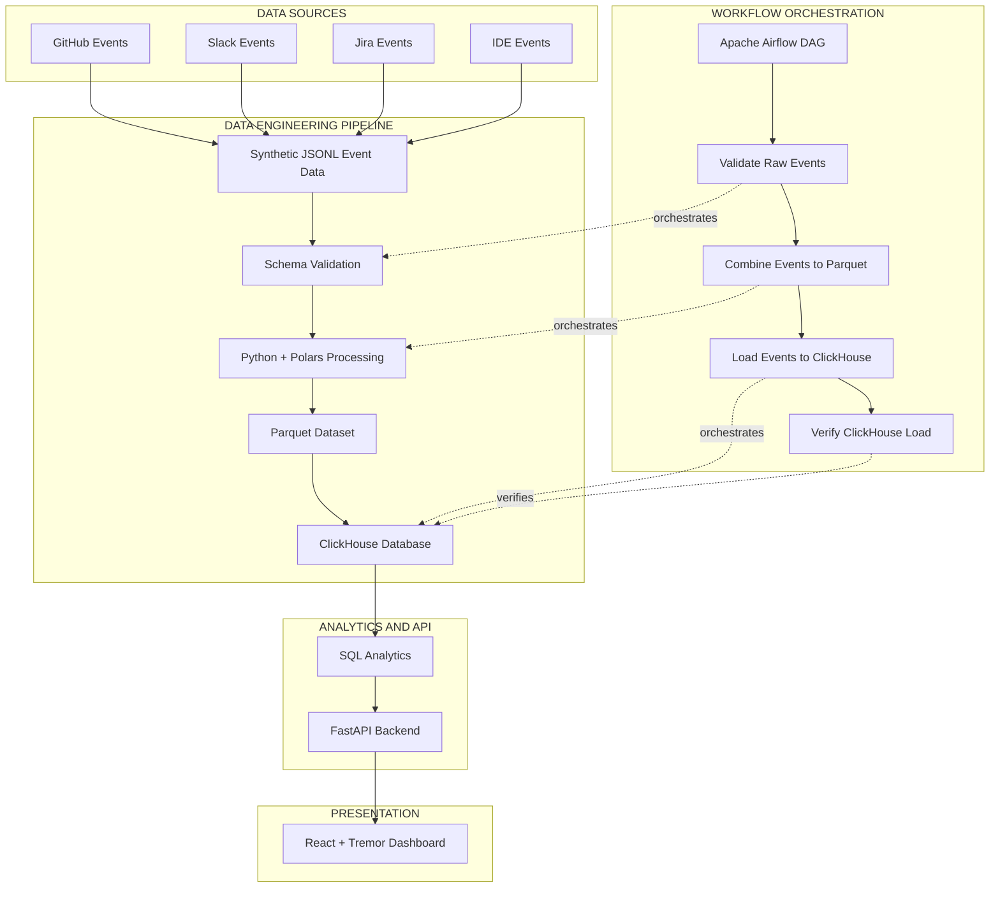

# CogniStream
### Developer Flow-State & Cognitive Load Analytics

CogniStream is an end-to-end data analytics and engineering project designed to analyze developer workflow activity across multiple development tools. It transforms synthetic GitHub, Slack, Jira, and IDE events into structured analytical datasets and presents workflow activity insights through an interactive dashboard.

The project demonstrates an integrated data engineering and analytics workflow using Python, Polars, Apache Airflow, ClickHouse, SQL, FastAPI, React, and Tremor.

---

## Project Overview

Modern software development involves switching between multiple tools and platforms throughout the workday. Understanding these activity patterns can help teams identify workflow interruptions, tool transitions, and periods of developer activity.

CogniStream processes event-level activity data to explore these patterns through analytical metrics and interactive visualizations.

**Project objectives:**
- Simulate developer activity across multiple development platforms.
- Validate incoming events using structured schemas.
- Process and transform event data using Python and Polars.
- Store processed data in ClickHouse.
- Analyze developer activity and source transitions using SQL.
- Expose analytical results through REST APIs.
- Visualize workflow insights through an interactive React dashboard.
- Orchestrate pipeline execution using Apache Airflow.

## Key Features

- **Multi-source event ingestion:** Synthetic events from GitHub, Slack, Jira, and IDE activity.
- **Schema validation:** Validation of incoming JSONL events before processing.
- **Data transformation:** Event processing and Parquet generation using Polars.
- **Analytical storage:** Centralized event storage in ClickHouse.
- **SQL analytics:** Developer activity, source activity, hourly trends, and source-transition analysis.
- **REST API:** FastAPI endpoints serving dashboard analytics.
- **Interactive dashboard:** React and Tremor-based visualizations with team and developer filters.
- **Workflow orchestration:** Apache Airflow DAG coordinating validation, processing, loading, and verification.
- **Automated testing:** Backend and analytics tests using pytest.

## Architecture

The following diagram illustrates the data flow and orchestration architecture of CogniStream.



**Architecture explanation:**

1. Synthetic developer activity events are generated from four sources.
2. Incoming JSONL records undergo schema validation.
3. Python and Polars process the validated events.
4. Processed events are stored as Parquet files.
5. Data is loaded into ClickHouse for analytical querying.
6. SQL queries generate workflow and transition analytics.
7. FastAPI exposes analytical results through REST endpoints.
8. React and Tremor display the results in an interactive dashboard.
9. Apache Airflow orchestrates the pipeline tasks and verifies the ClickHouse load.

## Technology Stack

| Technology | Purpose | Status |
|---|---|---|
| Python | Data processing and backend development | Implemented |
| Polars | Data transformation and processing | Implemented |
| Apache Airflow | Pipeline orchestration | Implemented and tested |
| ClickHouse | Analytical database | Implemented |
| SQL | Workflow and transition analytics | Implemented |
| FastAPI | REST API development | Implemented and tested |
| React | Frontend dashboard | Implemented and tested |
| Tremor.js | Dashboard visualizations | Implemented and tested |
| Tailwind CSS | Frontend styling | Implemented |
| pytest | Automated testing | Implemented and tested |
| Docker | Containerized services | Implemented |

## Dataset Overview

CogniStream uses synthetic developer activity data generated across four sources:

| Data Source | Events |
|---|---:|
| GitHub | 30 |
| Slack | 30 |
| Jira | 30 |
| IDE | 30 |
| **Total** | **120** |

**Dataset characteristics:**
- Total events: 120
- Data sources: 4
- Developers: 5
- Teams: 2
- Unique event IDs: 120
- Data format: JSONL and Parquet

The synthetic dataset is intended for demonstrating data engineering and analytics workflows. It does not represent real developer activity.

## Data Processing Pipeline

The pipeline consists of the following stages:

**1. Event ingestion**

Synthetic JSONL event files are maintained separately for GitHub, Slack, Jira, and IDE activity.

**2. Schema validation**

Incoming records are validated against their respective event schemas before processing.

**3. Data transformation**

Polars combines and processes the validated event data into a unified dataset.

**4. Parquet generation**

The processed events are stored in Parquet format for efficient analytical processing.

**5. ClickHouse loading**

The unified dataset is loaded into the `cognistream` database, in the `developer_events` table.

**6. Data verification**

The pipeline verifies the ClickHouse load, including the expected event count.

## Apache Airflow Orchestration

CogniStream uses an Apache Airflow DAG named:

`cognistream_pipeline`

The DAG contains four sequential tasks:

| Task | Description |
|---|---|
| `validate_raw_events` | Validates raw JSONL event records |
| `combine_events_to_parquet` | Processes events and generates the Parquet dataset |
| `load_events_to_clickhouse` | Loads processed events into ClickHouse |
| `verify_clickhouse_load` | Verifies the ClickHouse data load |

**Pipeline validation result:**

All four tasks completed successfully during a manual DAG execution.

## Analytics Methodology

CogniStream focuses on understanding developer activity patterns and source transitions.

### 1. Developer Activity Analysis
- Event counts by developer.
- Developer-level activity distribution.
- Activity breakdown by source.

### 2. Source Activity Analysis
- Event counts by platform.
- Distribution across GitHub, Slack, Jira, and IDE.
- Source-level activity comparisons.

### 3. Hourly Activity Trends
- Event distribution across hours.
- Identification of activity patterns throughout the day.

### 4. Source Transition Analysis

Source transitions are identified when consecutive events for a developer belong to different sources.

The analysis uses event timestamps and developer/team identifiers to calculate the time gap between consecutive events.

### 5. Transition Gap Classification

Transition gaps are classified using a configurable 30-minute threshold:

- **Short gap:** 30 minutes or less.
- **Long gap:** More than 30 minutes.

The current dataset contains:

| Metric | Result |
|---|---:|
| Total source transitions | 94 |
| Short-gap transitions | 42 |
| Long-gap transitions | 52 |
| Developers analyzed | 5 |

These classifications are exploratory analytical proxies. They should not be interpreted as direct measurements of cognitive load, interruptions, recovery, productivity, or mental state.

## FastAPI Backend

FastAPI provides REST endpoints to serve analytical data to the React dashboard.

**Available endpoints:**

| Endpoint | Description |
|---|---|
| `/` | Root endpoint |
| `/health` | Backend health check |
| `/api/v1/summary` | Overall project metrics |
| `/api/v1/trends/hourly` | Hourly event trends |
| `/api/v1/developers/activity` | Developer activity analysis |
| `/api/v1/sources/activity` | Source activity analysis |
| `/api/v1/context-switches` | Source transition analysis |
| `/api/v1/transitions/summary` | Team-level transition summary |
| `/api/v1/developers/transitions/summary` | Developer-level transition summary |

The backend connects to ClickHouse and provides the aggregated results required by the dashboard.

## Interactive Dashboard

The frontend is developed using **React, Tremor.js, and Tailwind CSS**.

The dashboard provides an interactive view of developer workflow activity.

**Dashboard capabilities:**
- KPI cards for overall event and developer metrics.
- Hourly activity trend visualization.
- Developer activity breakdown.
- Source-level activity comparison.
- Context-switch analytics.
- Developer-level transition analysis.
- Team-level source transition analysis.
- Recent source transition records.
- Team and developer filters.

Dashboard data is retrieved from the FastAPI backend.

## Project Validation and Testing

CogniStream has been validated across its data processing, database, backend, orchestration, and frontend components.

### Validation Results

| Component | Validation |
|---|---|
| Event schema validation | 120/120 valid events |
| Unique event IDs | 120 |
| ClickHouse loading | 120 events verified |
| Source distribution | 30 events per source |
| Airflow DAG | All 4 tasks successful |
| Analytics API | 7 endpoints tested |
| Frontend dashboard | Functional validation completed |

### Automated Tests

The project test suite was executed using:

```powershell
python -m pytest -q
```

**Latest test result:**

`46 passed, 1 warning`

The warning relates to a Starlette deprecation notice and did not cause test failures.

## Project Structure

```text
CogniStream/
│
├── airflow/
│   └── dags/
│
├── backend/
│   └── app/
│       ├── api/
│       ├── services/
│       └── main.py
│
├── data/
│   ├── raw/
│   └── processed/
│
├── docs/
│
├── frontend/
│   ├── src/
│   ├── public/
│   └── package.json
│
├── ingestion/
│   └── schemas/
│
├── processing/
│
├── sql/
│   └── analytics/
│
├── tests/
│
├── requirements.txt
└── README.md
```

## Getting Started

Follow these instructions to set up CogniStream locally.

### Prerequisites

- Python
- Node.js and npm
- Docker Desktop
- Git

### 1. Clone the Repository

```powershell
git clone https://github.com/SHREYASHRAW/CogniStream.git
cd CogniStream
```

### 2. Set Up Python Environment

```powershell
python -m venv .venv
.venv\Scripts\activate
```

Install dependencies:

```powershell
pip install -r requirements.txt
```

### 3. Configure Environment Variables

Create a `.env` file in the project root and configure your local ClickHouse connection:

```env
CLICKHOUSE_HOST=localhost
CLICKHOUSE_PORT=8123
CLICKHOUSE_DATABASE=cognistream
CLICKHOUSE_USER=cogni
CLICKHOUSE_PASSWORD=your_local_password
```

Replace the password with the password configured in your local ClickHouse environment.

Do not commit `.env` or any credentials to GitHub.

### 4. Start the Services

Start the configured Docker services for ClickHouse and Airflow.

Ensure ClickHouse is accessible on port `8123`.

### 5. Run the Backend

From the project root:

```powershell
python -m uvicorn backend.app.main:app --reload
```

Backend address:

`http://127.0.0.1:8000`

### 6. Run the Frontend

Open another terminal:

```powershell
cd frontend
npm install
npm run dev
```

Open the local Vite development URL displayed in your terminal, normally:

`http://localhost:5173/`

### 7. Run Automated Tests

From the project root:

```powershell
python -m pytest -q
```

### 8. Run the Airflow Pipeline

Run the `cognistream_pipeline` DAG using your configured Airflow environment.

The DAG executes validation, Parquet processing, ClickHouse loading, and load verification.

## Project Demonstration

A typical demonstration workflow:

1. Start the ClickHouse and Airflow services.
2. Execute the Airflow pipeline.
3. Confirm that the event dataset is loaded into ClickHouse.
4. Start the FastAPI backend.
5. Start the React frontend.
6. Open the dashboard.
7. Explore developer activity, source activity, hourly trends, and transition analytics.
8. Apply team and developer filters to explore the analytical results.

## Current Limitations

- The dataset is synthetic and relatively small.
- The project does not currently ingest live developer activity from external platforms.
- The 30-minute transition threshold is configurable and exploratory.
- Source transitions are workflow activity proxies, not direct measurements of cognitive state or productivity.
- The dashboard and API operate on the currently loaded analytical dataset.

## Future Enhancements

Potential improvements include:

- Integration with real GitHub, Slack, Jira, and IDE event sources.
- Larger and more diverse event datasets.
- Advanced workflow pattern analysis.
- More comprehensive historical trend analysis.
- Automated alerts for unusual workflow patterns.
- Further dashboard enhancements and deployment.

## Project Information

**Project:** CogniStream  
**Category:** Data Engineering and Analytics  
**Focus:** Developer Workflow Analytics  
**Repository:** [SHREYASHRAW/CogniStream](https://github.com/SHREYASHRAW/CogniStream)

**Core Technologies:** Python, Polars, Apache Airflow, ClickHouse, SQL, FastAPI, React, Tremor.js, Tailwind CSS, Docker, and pytest.

---

*CogniStream demonstrates an end-to-end data engineering and analytics workflow, from synthetic event generation and processing to analytical storage, API development, orchestration, and interactive visualization.*